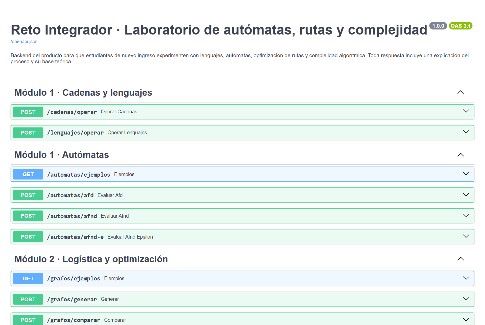
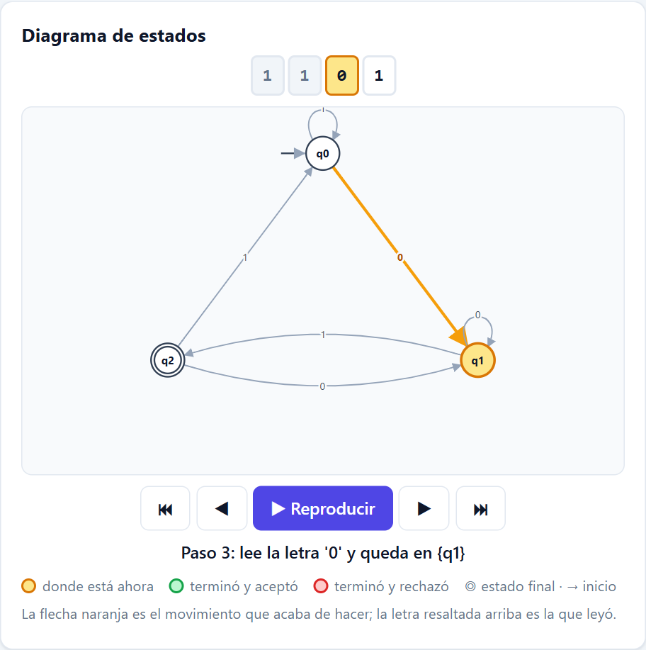
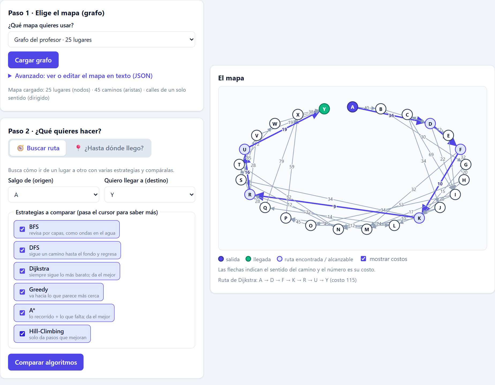
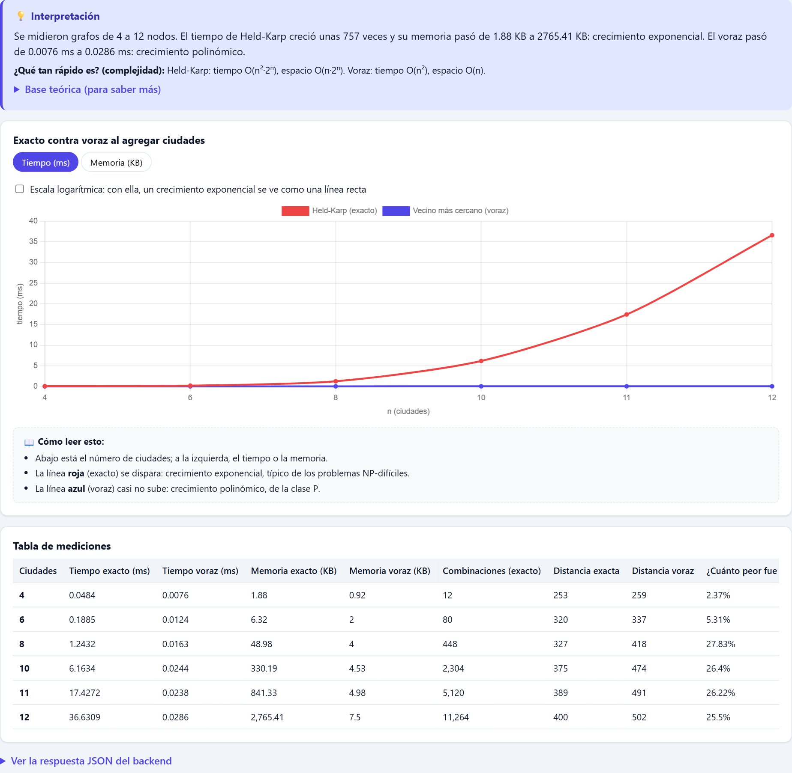

# Reto Integrador · Laboratorio de Autómatas, Rutas y Complejidad

Producto educativo para que estudiantes de nuevo ingreso **experimenten** con lenguajes formales, autómatas finitos, búsqueda de rutas en grafos y complejidad algorítmica. Cada operación devuelve el resultado, la traza paso a paso, métricas de tiempo y memoria, y una **explicación en lenguaje sencillo con su base teórica**.


| Carpeta | Contenido | Entrega |
|---|---|---|
| [`app/`](app/), [`tests/`](tests/) | Backend: API REST en FastAPI con algoritmos, explicaciones, endpoints y pruebas | Checkpoint 1 |
| [`frontend/`](frontend/README.md) | Interfaz gráfica en HTML, CSS y JavaScript puro que consume la API | Checkpoint 2 |
| [`docs/`](docs/) | Manual de usuario en PDF y capturas de pantalla | Documentación |

📘 **Manual de usuario:** [`docs/Manual_de_Usuario.pdf`](docs/Manual_de_Usuario.pdf)

---

## Contenido

1. [Inicio rápido](#inicio-rápido)
2. [Requisitos](#requisitos)
3. [Instalación y ejecución](#instalación-y-ejecución)
4. [Arquitectura](#arquitectura)
5. [Estructura del proyecto](#estructura-del-proyecto)
6. [Módulos funcionales](#módulos-funcionales)
7. [Referencia de la API](#referencia-de-la-api)
8. [Frontend](#frontend)
9. [Pruebas](#pruebas)
10. [Límites y decisiones de diseño](#límites-y-decisiones-de-diseño)
11. [Solución de problemas](#solución-de-problemas)

---

## Inicio rápido

Abre dos terminales en la raíz del repositorio:

```bash
# Terminal 1 · backend (puerto 8000)
pip install -r requirements.txt
uvicorn app.main:app --reload

# Terminal 2 · frontend (puerto 5500)
cd frontend
python -m http.server 5500
```

Abre **http://localhost:5500**. Arriba a la derecha debe aparecer **Backend conectado** en verde.

## Requisitos

| Herramienta | Versión | Para qué |
|---|---|---|
| Python | 3.10 o superior | Backend (usa la sintaxis `int \| float` en los tipos) |
| pip | cualquiera reciente | Instalar dependencias |
| Navegador moderno | Chrome, Edge, Firefox | Interfaz gráfica |
| Internet (opcional) | — | El frontend carga Chart.js 4.4.1 desde cdnjs para las gráficas |

Dependencias del backend ([`requirements.txt`](requirements.txt)):

| Paquete | Uso |
|---|---|
| `fastapi >= 0.110` | Framework de la API |
| `uvicorn[standard] >= 0.27` | Servidor ASGI |
| `pydantic >= 2.0` | Validación de las entradas |
| `pytest >= 8.0`, `httpx >= 0.27` | Pruebas automáticas |

El frontend **no necesita instalación ni compilación**.

## Instalación y ejecución

### 1. Backend

```bash
# desde la raíz del repositorio
python -m venv .venv               # opcional, recomendado
.venv\Scripts\activate             # Windows  (Linux/macOS: source .venv/bin/activate)
pip install -r requirements.txt
uvicorn app.main:app --reload
```

| URL | Qué hay |
|---|---|
| http://localhost:8000/ | Índice con la lista de endpoints por módulo |
| http://localhost:8000/docs | Documentación interactiva Swagger: cada endpoint trae un ejemplo listo para probar |
| http://localhost:8000/redoc | La misma documentación en formato ReDoc |



### 2. Frontend

```bash
cd frontend
python -m http.server 5500
```

Abre http://localhost:5500. Se sirve con `http.server` porque los navegadores no cargan módulos de JavaScript (`type="module"`) desde `file://`.

Si el backend corre en otra dirección o puerto, haz clic en el indicador **Backend conectado / sin conexión** del encabezado, escribe la URL y presiona **Guardar y reconectar**. La URL se guarda en el navegador.

---

## Arquitectura

El sistema separa las tres capas que pide el reto:

```
┌──────────────────────────────────────────────────────────────┐
│  3. Interfaz gráfica (frontend/)                              │
│     HTML + CSS + JS · formularios, diagramas SVG, Chart.js    │
└───────────────────────────────┬──────────────────────────────┘
                                │ HTTP / JSON (fetch)
┌───────────────────────────────▼──────────────────────────────┐
│  API · app/routers/ + app/schemas/                            │
│  Endpoints FastAPI y validación con Pydantic                  │
├──────────────────────────────────────────────────────────────┤
│  2. Interpretación y explicabilidad · app/explicaciones/      │
│  Convierte cada resultado en resumen, teoría y complejidad    │
├──────────────────────────────────────────────────────────────┤
│  1. Cómputo determinista · app/services/                      │
│  Algoritmos puros en Python, sin dependencias de FastAPI      │
└──────────────────────────────────────────────────────────────┘
```

| Capa | Carpeta | Responsabilidad |
|---|---|---|
| Cómputo determinista | `app/services/` | Autómatas, cadenas, lenguajes, búsquedas, ordenamientos, TSP y medición. No conoce HTTP. |
| Interpretación | `app/explicaciones/` | Genera el texto "¿Qué pasó?", la base teórica y la complejidad de cada operación. |
| API | `app/routers/`, `app/schemas/` | Define los endpoints, valida entradas y arma la respuesta común. |
| Presentación | `frontend/` | Muestra resultados, diagramas, trazas y gráficas. |

### Formato común de respuesta

Todos los endpoints `POST` responden con la misma forma ([`app/respuesta.py`](app/respuesta.py)), lo que permite al frontend reutilizar los mismos componentes:

```json
{
  "modulo": "automatas",
  "operacion": "AFD",
  "resultado": { "aceptada": true, "diagrama": { "nodos": [], "aristas": [] } },
  "pasos": [ { "paso": 1, "simbolo": "1", "desde": "q0", "hacia": "q0" } ],
  "explicacion": {
    "resumen": "La cadena '1101' es ACEPTADA…",
    "teoria": "Un AFD es una 5-tupla (Q, Σ, δ, q₀, F)…",
    "complejidad": "O(|w|): se hace una sola transición por cada símbolo…"
  },
  "metricas": { "tiempo_ms": 0.01, "memoria_pico_kb": 1.2 }
}
```

| Campo | Contenido |
|---|---|
| `modulo` | `lenguajes`, `automatas`, `grafos` o `benchmark` |
| `operacion` | Nombre de la operación ejecutada |
| `resultado` | Datos calculados (cambia según el endpoint) |
| `pasos` | Traza paso a paso (autómatas) |
| `explicacion` | `resumen`, `teoria` y, si aplica, `complejidad` |
| `metricas` | `tiempo_ms` y `memoria_pico_kb` |

### Manejo de errores

| Código | Cuándo | Cuerpo |
|---|---|---|
| `400` | Datos con forma correcta pero inválidos (estado inicial que no existe, nodo inexistente, símbolo fuera de Σ…) | `{"error": "mensaje en español"}` |
| `422` | Falta un campo, tipo incorrecto o valor fuera de rango (validación Pydantic) | Formato estándar de FastAPI |

Los errores `400` se lanzan con la excepción `ErrorEntrada` ([`app/errores.py`](app/errores.py)) y un manejador global en [`app/main.py`](app/main.py) los convierte en JSON. El frontend muestra ambos tipos en un recuadro rojo y un aviso flotante.

### Medición de tiempo y memoria

[`app/services/medicion.py`](app/services/medicion.py) ejecuta cada algoritmo con `time.perf_counter()` y se queda con **el mejor tiempo** de varias repeticiones. La **memoria pico** se mide en una corrida aparte con `tracemalloc`, porque rastrear la memoria hace más lento el código y alteraría el tiempo.

---

## Estructura del proyecto

```
reto-integrador-backend/
├── README.md                       Este documento
├── requirements.txt
├── pytest.ini
├── docs/
│   ├── Manual_de_Usuario.pdf       Manual de usuario con capturas
│   └── capturas/                   Capturas de pantalla del frontend
├── app/
│   ├── main.py                 Aplicación FastAPI, CORS, manejador de errores, ruta "/"
│   ├── respuesta.py            Formato común de respuesta
│   ├── errores.py              ErrorEntrada → HTTP 400
│   ├── datos/
│   │   ├── automatas_ejemplo.json   AFD, AFND y AFND-ε de ejemplo
│   │   └── grafos_profesor.json     Grafos de 10, 25 y 50 nodos
│   ├── routers/                Endpoints por módulo
│   │   ├── lenguajes.py        /cadenas, /lenguajes
│   │   ├── automatas.py        /automatas
│   │   ├── grafos.py           /grafos
│   │   └── benchmark.py        /benchmark
│   ├── schemas/                Modelos Pydantic de entrada (con ejemplos para /docs)
│   ├── services/               Algoritmos
│   │   ├── cadenas.py          Operaciones sobre cadenas
│   │   ├── lenguajes.py        Operaciones sobre lenguajes (acotadas por k)
│   │   ├── automatas.py        AFD, AFND, AFND-ε, cerradura-ε, diagrama
│   │   ├── grafos.py           Normalizar, generar y dibujar grafos
│   │   ├── busquedas.py        BFS, DFS, Dijkstra, Greedy, A*, Hill-Climbing, alcance
│   │   ├── ordenamientos.py    8 algoritmos de ordenamiento con contadores
│   │   ├── tsp.py              Held-Karp (exacto) y vecino más cercano (voraz)
│   │   └── medicion.py         Tiempo y memoria pico
│   └── explicaciones/          Textos de interpretación y teoría por módulo
├── tests/                          118 pruebas con pytest
└── frontend/
    ├── index.html                  Encabezado, pestañas y secciones
    ├── css/estilos.css             Diseño visual
    └── js/
        ├── main.js                 Arranque, pestañas e indicador de conexión
        ├── api.js                  get()/post() al backend y traducción de errores
        ├── ui.js                   Componentes compartidos (tablas, gráficas, avisos…)
        ├── diagrama.js             Dibujo de autómatas y grafos en SVG
        ├── modulo1.js              Cadenas, lenguajes y autómatas
        ├── modulo2.js              Grafos: rutas y alcance
        └── modulo3.js              Ordenamiento, TSP y escalabilidad
```

---

## Módulos funcionales

### Módulo 1 · Traductor de lenguajes y verificador de reglas

**Cadenas.** Sobre una cadena `w` (y opcionalmente `v`, `n` y un alfabeto `Σ`):

| Operación | Resultado |
|---|---|
| `longitud` | \|w\| |
| `inversa` | wᴿ |
| `concatenacion` | w·v |
| `potencia` | wⁿ |
| `prefijos`, `sufijos`, `subcadenas` | Conjuntos ordenados por longitud y luego alfabéticamente, incluyendo ε |
| `palindromo` | Si w = wᴿ |
| `conteo` | Número de apariciones de cada símbolo |
| `alfabeto` | Si w ∈ Σ* (y qué símbolos sobran) |

**Lenguajes.** Sobre dos lenguajes finitos `L` y `M`: `union`, `interseccion`, `diferencia`, `diferencia_simetrica`, `concatenacion`, `potencia` (Lⁿ), `kleene` (L*), `positiva` (L⁺), `inversa` (Lᴿ) y `complemento`. Como L*, L⁺ y el complemento son infinitos, se calculan **hasta la cota `k`**: L* = L⁰ ∪ … ∪ Lᵏ y el complemento dentro de Σ^≤k.

**Autómatas finitos.**

| Tipo | Transiciones | Algoritmo |
|---|---|---|
| AFD | `{"q0": {"a": "q1"}}` | Una transición por símbolo, O(\|w\|) |
| AFND | `{"q0": {"a": ["q0", "q1"]}}` | Simulación por conjuntos de estados, O(\|w\|·\|Q\|²) |
| AFND-ε | Igual que AFND más la clave `"ε"` | Igual, aplicando la cerradura-ε en cada paso |

Se valida que el estado inicial, los finales y los destinos existan en Q y que los símbolos pertenezcan a Σ. La respuesta incluye el veredicto, la traza paso a paso y el diagrama (nodos y aristas, con las aristas paralelas agrupadas).

### Módulo 2 · Asistente de logística y optimización

Seis algoritmos de búsqueda sobre el mismo grafo, origen y destino:

| Clave | Algoritmo | ¿Óptimo? | Idea |
|---|---|---|---|
| `bfs` | Búsqueda en anchura | En saltos, no en costo | Explora por capas |
| `dfs` | Búsqueda en profundidad | No | Avanza hasta el fondo y retrocede |
| `dijkstra` | Dijkstra | Sí | Expande el nodo de menor costo acumulado g(n) |
| `greedy` | Greedy Best-First | No | Expande el nodo de menor heurística h(n) |
| `a_estrella` | A* | Sí (h admisible) | Expande el de menor g(n) + h(n) |
| `hill_climbing` | Hill-Climbing (máximo descenso) | No | Se mueve al vecino de menor h(n) y nunca retrocede |

- **Heurística:** si se envían `coordenadas` para todos los nodos, se usa la distancia euclidiana; si no, el número mínimo de aristas hasta el destino (BFS sobre el grafo invertido). Para A* sin coordenadas, ese número se multiplica por el peso mínimo del grafo para que la heurística sea admisible (no sobreestima).
- **Alcance:** desde un origen calcula el costo mínimo (Dijkstra) y el mínimo de saltos (BFS) a cada nodo, con límites opcionales `costo_maximo` y `saltos_maximos`, e indica qué nodos quedan fuera.
- **Grafos disponibles:** los del profesor (10, 25 y 50 nodos, dirigidos y ponderados), uno pequeño de ejemplo y grafos aleatorios conexos con coordenadas (el peso es la distancia euclidiana redondeada hacia arriba; la misma semilla siempre da el mismo grafo).

### Módulo 3 · Auditoría de escalabilidad y benchmark

**Ordenamiento.** Compara al menos 2 de 8 algoritmos con exactamente los mismos datos:

| Clave | Algoritmo | Mejor | Promedio | Peor | Espacio | Estable |
|---|---|---|---|---|---|---|
| `burbuja` | Bubble sort | O(n) | O(n²) | O(n²) | O(1) | Sí |
| `seleccion` | Selection sort | O(n²) | O(n²) | O(n²) | O(1) | No |
| `insercion` | Insertion sort | O(n) | O(n²) | O(n²) | O(1) | Sí |
| `shell` | Shell sort | O(n log n) | ≈ O(n^1.5) | O(n²) | O(1) | No |
| `mergesort` | Merge sort | O(n log n) | O(n log n) | O(n log n) | O(n) | Sí |
| `quicksort` | Quicksort | O(n log n) | O(n log n) | O(n²) | O(log n) | No |
| `heapsort` | Montículo (Heapsort) | O(n log n) | O(n log n) | O(n log n) | O(1) | No |
| `timsort` | Timsort (`sorted` de Python) | O(n) | O(n log n) | O(n log n) | O(n) | Sí |

> La tabla exacta que usa la app se consulta en `GET /benchmark/ordenamiento/catalogo`.

Se reporta tiempo, memoria pico, comparaciones, movimientos, si el resultado quedó bien ordenado y un ranking. Con `tamanos` se agrega una curva de escalabilidad. Los datos pueden ser propios o generados: `aleatorio`, `ordenado`, `inverso`, `casi_ordenado` o `pocos_unicos`.

**Agente Viajero (TSP).** Compara el método exacto **Held-Karp** (programación dinámica, tiempo O(n²·2ⁿ), espacio O(n·2ⁿ)) contra la heurística voraz **vecino más cercano** (O(n²)) y calcula la **brecha porcentual** del voraz respecto al óptimo.

**Escalabilidad TSP (P vs NP).** Repite el TSP con varios tamaños (3 a 12 nodos) y muestra cómo el tiempo y la memoria del exacto crecen de forma exponencial mientras el voraz casi no cambia.

---

## Referencia de la API

Base: `http://localhost:8000`. Todos los cuerpos son JSON. La cadena vacía se escribe `"ε"` o `""` y se devuelve como `"ε"`. Cada símbolo del alfabeto es un carácter.

### Resumen de endpoints

| Método | Ruta | Módulo | Descripción |
|---|---|---|---|
| GET | `/` | — | Índice de la API |
| POST | `/cadenas/operar` | 1 | Operaciones sobre una cadena |
| POST | `/lenguajes/operar` | 1 | Operaciones sobre lenguajes |
| GET | `/automatas/ejemplos` | 1 | AFD, AFND y AFND-ε de ejemplo |
| POST | `/automatas/afd` | 1 | Evalúa una cadena en un AFD |
| POST | `/automatas/afnd` | 1 | Evalúa una cadena en un AFND |
| POST | `/automatas/afnd-e` | 1 | Evalúa una cadena en un AFND-ε |
| GET | `/grafos/ejemplos` | 2 | Grafos del profesor (10, 25, 50 nodos) |
| POST | `/grafos/generar` | 2 | Genera un grafo aleatorio conexo |
| POST | `/grafos/comparar` | 2 | Compara algoritmos de búsqueda |
| POST | `/grafos/alcance` | 2 | Nodos alcanzables desde un origen |
| GET | `/benchmark/ordenamiento/catalogo` | 3 | Algoritmos de ordenamiento y su complejidad |
| POST | `/benchmark/ordenamiento` | 3 | Benchmark de ordenamiento |
| POST | `/benchmark/tsp` | 3 | TSP exacto contra voraz |
| POST | `/benchmark/tsp/escalabilidad` | 3 | Curva de escalabilidad del TSP |

### `POST /cadenas/operar`

| Campo | Tipo | Requerido | Restricciones |
|---|---|---|---|
| `w` | string | sí | máx. 200 caracteres |
| `v` | string | no | máx. 200 (para `concatenacion`) |
| `n` | int | no | 0 a 50 (para `potencia`) |
| `sigma` | string[] | no | alfabeto (para `alfabeto`) |
| `operaciones` | string[] | sí | al menos 1 de las 10 operaciones |

```json
{ "w": "abba", "v": "ca", "n": 2, "sigma": ["a", "b"],
  "operaciones": ["longitud", "inversa", "concatenacion", "potencia", "palindromo", "alfabeto"] }
```

`resultado` es una lista con `{operacion, resultado, explicacion}` por cada operación.

### `POST /lenguajes/operar`

| Campo | Tipo | Defecto | Restricciones |
|---|---|---|---|
| `L`, `M` | string[] | `[]` | máx. 500 cadenas |
| `sigma` | string[] | `[]` | máx. 20 símbolos (para `complemento`) |
| `k` | int | 3 | 0 a 10 (cota de L*, L⁺ y Σ^≤k) |
| `n` | int | 2 | 0 a 10 (para Lⁿ) |
| `operaciones` | string[] | — | al menos 1 |

```json
{ "L": ["a", "ab"], "M": ["ab", "b"], "sigma": ["a", "b"], "k": 2, "n": 2,
  "operaciones": ["union", "interseccion", "concatenacion", "kleene", "complemento"] }
```

`resultado` es una lista con `{operacion, nombre, resultado, cardinalidad, explicacion}`.

### `POST /automatas/afd` · `/afnd` · `/afnd-e`

| Campo | Tipo | Descripción |
|---|---|---|
| `estados` | string[] | Q (al menos 1) |
| `alfabeto` | string[] | Σ |
| `inicial` | string | q₀ |
| `finales` | string[] | F |
| `transiciones` | objeto | AFD: `{"q0": {"0": "q1"}}` · AFND/AFND-ε: `{"q0": {"a": ["q0","q1"], "ε": ["q2"]}}` |
| `cadena` | string | máx. 500; `""` o `"ε"` = cadena vacía |

```json
{
  "estados": ["q0", "q1", "q2"], "alfabeto": ["0", "1"], "inicial": "q0", "finales": ["q2"],
  "transiciones": { "q0": {"0": "q1", "1": "q0"}, "q1": {"0": "q1", "1": "q2"}, "q2": {"0": "q1", "1": "q0"} },
  "cadena": "1101"
}
```

`resultado` trae `aceptada`, el estado (o conjunto) final, el `recorrido`, el `motivo` del veredicto y `diagrama`; `pasos` trae la traza (`paso`, `simbolo`, `desde`, `hacia`).

### `POST /grafos/generar`

| Campo | Tipo | Defecto | Rango |
|---|---|---|---|
| `n` | int | 8 | 2 a 30 nodos |
| `densidad` | float | 0.3 | 0 a 1 (1 = grafo completo) |
| `semilla` | int | 42 | — |

Devuelve `grafo`, `dirigido: false`, `coordenadas` y `diagrama`.

### `POST /grafos/comparar`

| Campo | Tipo | Defecto | Descripción |
|---|---|---|---|
| `grafo` | objeto | — | `{"A": [["B", 15], ["C", 22]]}` o `{"A": {"B": 15}}` |
| `dirigido` | bool | `true` | `false` = cada arista en ambos sentidos |
| `coordenadas` | objeto | `null` | `{"A": [x, y]}` para usar la heurística euclidiana |
| `origen`, `destino` | string | — | Deben existir en el grafo |
| `algoritmos` | string[] | `bfs, dfs, dijkstra, hill_climbing` | Cualquiera de los 6 |

```json
{
  "grafo": { "A": [["B",4],["C",2]], "B": [["D",5]], "C": [["B",1],["D",8],["E",10]], "D": [["E",2]], "E": [] },
  "dirigido": true, "origen": "A", "destino": "E",
  "algoritmos": ["bfs", "dfs", "dijkstra", "greedy", "a_estrella", "hill_climbing"]
}
```

`resultado.tabla` trae por algoritmo: `algoritmo`, `encontrado`, `camino`, `costo`, `saltos`, `nodos_expandidos`, `tiempo_ms`, `memoria_pico_kb`. `resultado.algoritmos` agrega el orden de visita y la explicación individual; `resultado.diagrama` sirve para dibujar el grafo.

### `POST /grafos/alcance`

Mismos campos de grafo, más `origen`, `costo_maximo` (opcional, ≥ 0) y `saltos_maximos` (opcional, ≥ 0). Devuelve los nodos alcanzables con su costo mínimo, saltos mínimos y camino, los nodos fuera de alcance y el diagrama.

### `POST /benchmark/ordenamiento`

| Campo | Tipo | Defecto | Restricciones |
|---|---|---|---|
| `algoritmos` | string[] | — | al menos 2 distintos |
| `datos` | number[] | `null` | datos propios, 1 a 2000 |
| `tamano` | int | 1000 | 1 a 2000 (si no se envían `datos`) |
| `tipo` | string | `aleatorio` | `aleatorio`, `ordenado`, `inverso`, `casi_ordenado`, `pocos_unicos` |
| `semilla` | int | 42 | — |
| `tamanos` | int[] | `null` | hasta 6 tamaños para la curva de escalabilidad |
| `incluir_datos` | bool | `true` | devolver datos de entrada y ordenados |

```json
{ "algoritmos": ["burbuja", "insercion", "mergesort", "quicksort"],
  "tamano": 1000, "tipo": "aleatorio", "tamanos": [100, 500, 1000] }
```

`resultado` trae `algoritmos` (métricas, contadores, `correcto`, `estable`, complejidad), `ranking`, `grafica` y, si se pidió, `escalabilidad`.

### `POST /benchmark/tsp`

| Campo | Tipo | Defecto | Restricciones |
|---|---|---|---|
| `grafo` | objeto | `null` | grafo propio; si se omite se genera uno completo |
| `dirigido` | bool | `false` | — |
| `n` | int | 6 | 3 a 12 nodos (grafo generado) |
| `semilla` | int | 42 | — |
| `inicio` | string | `null` | ciudad de inicio |

Devuelve `exacto` y `voraz` (camino, costo, estados evaluados, tiempo, memoria), `brecha_porcentaje` y `diagrama`.

### `POST /benchmark/tsp/escalabilidad`

| Campo | Tipo | Defecto | Restricciones |
|---|---|---|---|
| `tamanos` | int[] | `[4, 6, 8, 10]` | 1 a 8 valores, cada uno entre 3 y 12 |
| `semilla` | int | 42 | — |

Devuelve `tabla` (una fila por tamaño con tiempo, memoria, costo y brecha de ambos métodos) y `grafica`.

---

## Frontend

HTML, CSS y JavaScript puro con módulos ES. Las gráficas usan [Chart.js 4.4.1](https://www.chartjs.org/) y los diagramas de autómatas y grafos se dibujan en SVG con código propio ([`diagrama.js`](frontend/js/diagrama.js)).

| Parte de la respuesta | Componente que la muestra |
|---|---|
| `resultado` | Tablas, tarjetas, conjuntos y diagramas de cada operación |
| `resultado.diagrama` | `dibujarDiagrama()` en SVG |
| `pasos` | Tabla de traza y reproductor paso a paso (⏮ ◀ ▶ ⏭) |
| `explicacion` | Recuadro azul **💡 ¿Qué pasó?** |
| `metricas` | Indicadores de tiempo (ms) y memoria (KB) |
| Errores 400 / 422 | Recuadro rojo y aviso flotante |

Pensado para principiantes: pestaña de **Inicio** con glosario, recuadro amarillo **📘 ¿Qué es esto?** en cada sección con una analogía de la vida diaria, notas **📖 Cómo leer esto** junto a cada tabla y gráfica, y la opción **Ver la respuesta JSON del backend** en todos los resultados.

| Módulo 1 · Autómatas | Módulo 2 · Rutas | Módulo 3 · Benchmark |
|---|---|---|
|  |  |  |

La guía paso a paso de cada pantalla está en el [**Manual de usuario**](docs/Manual_de_Usuario.pdf). Más detalles técnicos del frontend en [`frontend/README.md`](frontend/README.md).

---

## Pruebas

```bash
python -m pytest
```

118 pruebas en [`tests/`](tests/) cubren los servicios y los endpoints de los tres módulos (con `TestClient` de FastAPI):

| Archivo | Qué prueba |
|---|---|
| `test_lenguajes.py` | Operaciones con cadenas y lenguajes, cadena vacía, cotas |
| `test_automatas.py` | AFD, AFND, AFND-ε, cerradura-ε y errores de validación |
| `test_grafos.py` | Los 6 algoritmos, alcance, generación de grafos y grafos del profesor |
| `test_benchmark.py` | Ordenamientos, TSP exacto contra voraz y escalabilidad |

---

## Límites y decisiones de diseño

| Límite | Motivo |
|---|---|
| Ordenamiento: máximo 2000 elementos | Medir la memoria con `tracemalloc` hace unas 30 veces más lentos a los algoritmos O(n²). Con los 8 algoritmos y 2000 elementos la respuesta tarda ≈ 18 s; con 1000 elementos y 4 algoritmos, ≈ 3 s. |
| TSP exacto: máximo 12 nodos | Held-Karp crece como n²·2ⁿ en tiempo y n·2ⁿ en memoria. |
| Lenguajes: L*, L⁺ y complemento acotados por `k` ≤ 10 | Son conjuntos infinitos; se muestran las cadenas de longitud ≤ k. |
| Grafos generados: 2 a 30 nodos | Para que el diagrama siga siendo legible. |
| Tiempo = mejor de varias repeticiones | Reduce el ruido del sistema operativo en algoritmos muy rápidos. |
| CORS abierto (`allow_origins=["*"]`) | Proyecto académico local; en producción se limitaría al dominio del frontend. |

## Solución de problemas

| Síntoma | Solución |
|---|---|
| **Backend sin conexión** en rojo | Revisa que `uvicorn` esté corriendo en la terminal 1 y que la URL del indicador sea `http://localhost:8000`. |
| La página sale en blanco o sin estilos al abrir `index.html` con doble clic | Sírvela con `python -m http.server 5500` y abre `http://localhost:5500`. |
| No aparecen las gráficas | Chart.js se carga desde internet; revisa la conexión. |
| `ModuleNotFoundError: app` | Ejecuta `uvicorn` desde la raíz del repositorio. |
| El benchmark tarda mucho | Reduce `n` o quita algoritmos O(n²) (burbuja, selección, inserción). |
| Error 422 | Falta un campo o un valor está fuera de rango; el mensaje indica cuál. |

---

**Reto Integrador · Lenguajes de Comunicación**
